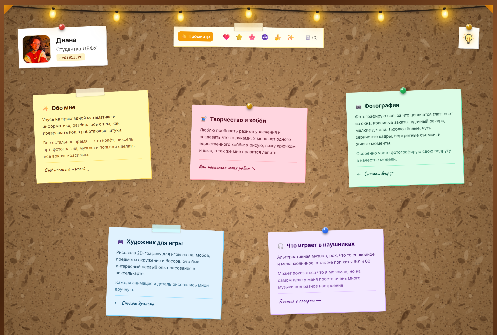
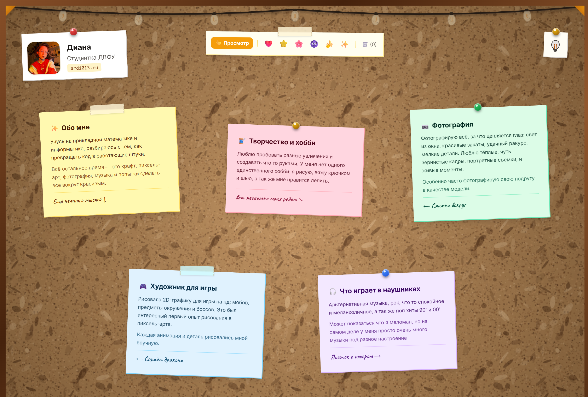
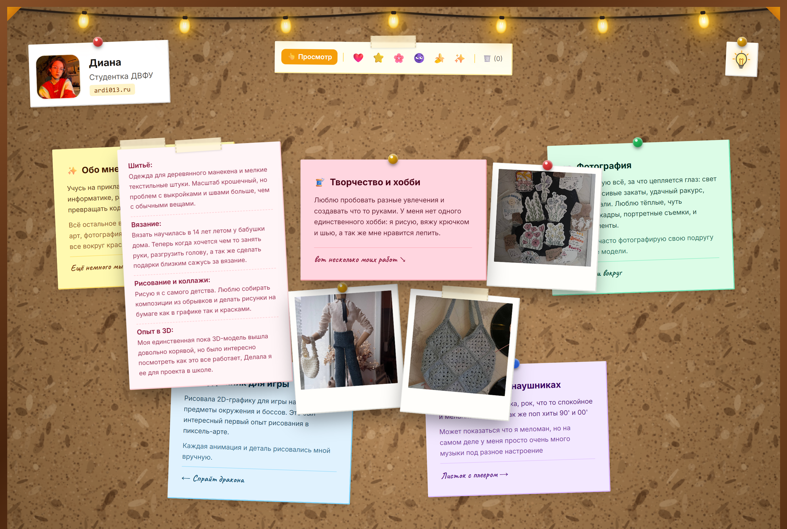
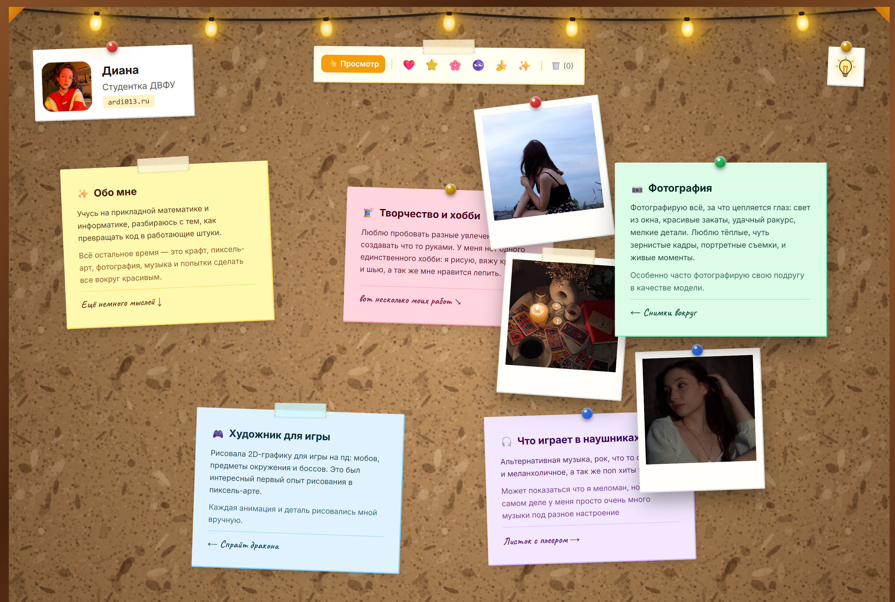
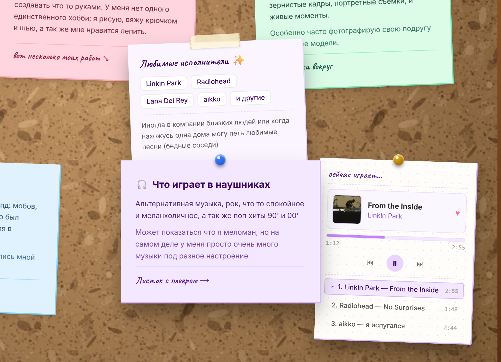
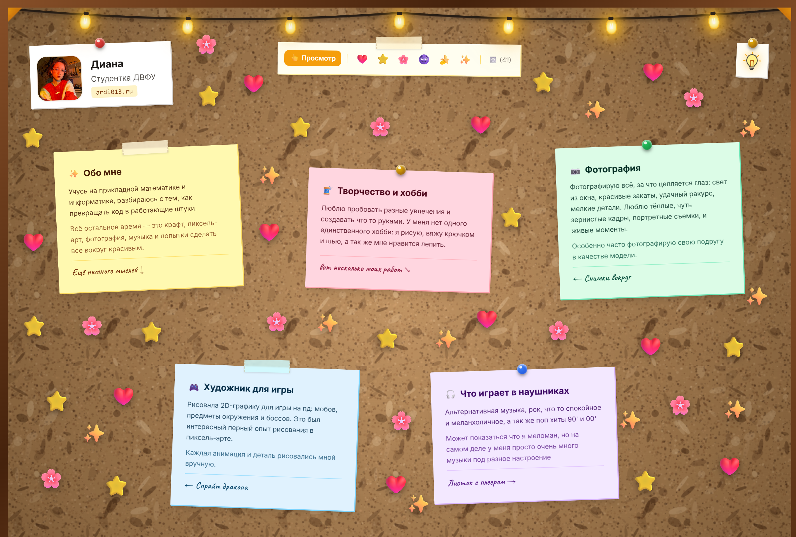
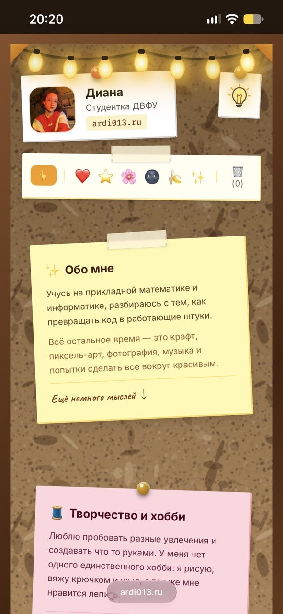
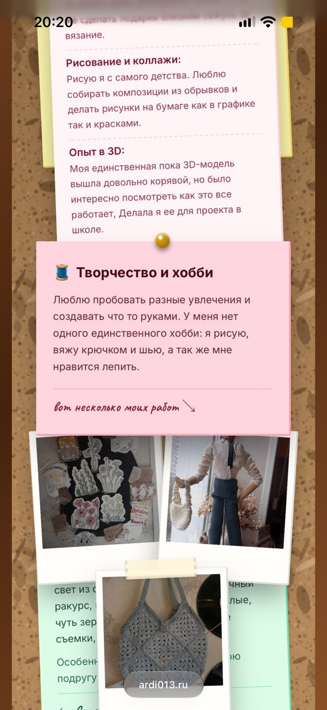
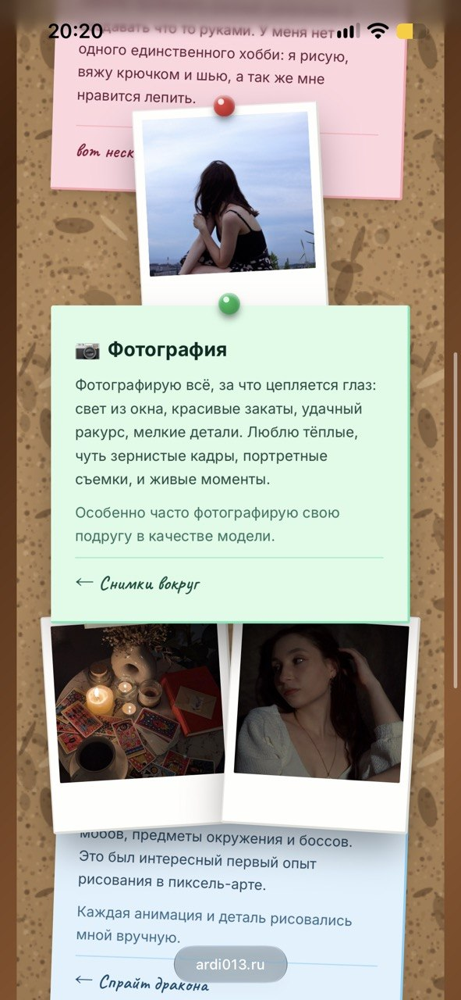
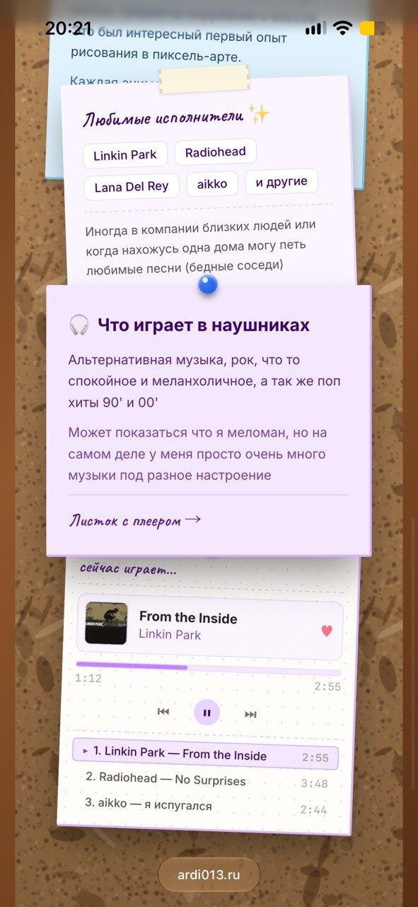

# Лабораторная работа №2: Персональный сайт (Personal Corkboard Website)

Интерактивное веб-приложение, стилизованное под физическую пробковую доску с многослойными бумажными заметками, полароидными фотокарточками и интерактивным виджетом медиаплеера.

Интерфейс не использует сторонних JS-фреймворков и тяжелых библиотек компонентов: рендеринг процедурного фона реализован нативно через HTML5 Canvas API, адаптивная разметка построена на Tailwind CSS, анимация раскладка основана на аппаратных CSS3-трансформациях, а управление состоянием стикеров сохраняется в браузере через Web Storage API (LocalStorage).

---

## Интерфейс приложения

### 1. Главный экран и система освещения

Интерфейс выполнен в виде рабочей доски с металлическими уголками, деревянной рамой и декоративной гирляндой. Подсветка переключается интерактивной кнопкой-лампой в шапке сайта.

| Освещение включено (по умолчанию) | Освещение выключено |
| :---: | :---: |
|  |  |

---

### 2. Тематические интерактивные карточки

Информация на доске сгруппирована по пяти основным блокам:
- **Обо мне** — сведения об учёбе на направлении прикладной математики и информатики, первых шагах в программировании и отдыхе.
- **Творчество и хобби** — крафтовые работы (коллажи, шитьё одежды для деревянного манекена, вязание, 3D-моделирование).
- **Фотография** — подборка плёночных и цифровых кадров, оформленных в виде полароидных карточек.
- **Художник для игры** — 2D пиксель-арт для проекта, спрайты окружения и анимация босса.
- **Что играет в наушниках** — любимые музыкальные направления и список исполнителей.

На настольных устройствах вложения раскрываются при наведении курсора. При клике карточка фиксируется в открытом состоянии, блокируя случайное открытие соседних элементов.

| Карточка творчества в раскрытом виде | Фотогалерея (полароиды) |
| :---: | :---: |
|  |  |

---

### 3. Бумажный аудиоплеер и интерактивные стикеры

В правом нижнем блоке расположен интерактивный аудиоплеер, стилизованный под блокнотный лист. Плеер поддерживает переключение треков, динамическую смену мини-обложек, полосы прогресса и статуса воспроизведения.

В верхней панели доступен инструмент наклеивания стикеров: пользователь может выбрать стикер и разместить его в любой свободной области доски. Координаты, угол наклона и список наклеенных элементов автоматически сохраняются на стороне клиента.

| Интерактивный плеер треков | Режим размещения стикеров |
| :---: | :---: |
|  |  |

---

### 4. Мобильная адаптивная версия

Для экранов смартфонов полностью переработана компоновка: вложения и полароиды раскрываются строго вертикально (вверх и вниз от родительской карточки), не выходя за пределы экрана по ширине. 

При открытии нижнего блока с аудиоплеером автоматически резервируется нижний отступ страницы (`margin-bottom: 255px`), исключая перекрытие и обрезку элементов рамкой доски.

| Главный экран и шапка | Карточка «Творчество и хобби» |
| :---: | :---: |
|  |  |

| Фотогалерея (полароиды) | Музыкальный плеер |
| :---: | :---: |
|  |  |

---

## Архитектура и стек технологий

### 1. Процедурный генератор текстуры (HTML5 Canvas API):

- Формирование бесшовного паттерна размером 320x320 px в рантайме без загрузки тяжёлых растровых фонов.
- Генерация 4500 микрочастиц переменного радиуса (r от 0.3 до 2.3 px) шестью земляными оттенками и 80 эллиптических структур коры дерева с альфа-каналом от 0.15 до 0.50.
- Сериализация холста в Data URL (`canvas.toDataURL()`) и монтирование в CSS через свойство `background-image` совместно с радиальным виньетированием, исключающее лишние перерисовки при скролле.

### 2. Пространственная геометрия и анимации (Tailwind CSS / Custom CSS3):

- Компоновка сетки на CSS Grid с адаптивным перестроением колонок (от 1 колонки на мобильных до 6 колонок на широких экранах).
- Индивидуальная матрица смещений для каждого вылетающего листа (`transform: translate(...) rotate(...) scale(...)`).
- Аппаратное ускорение анимаций с кастомным таймингом `cubic-bezier(0.34, 1.56, 0.64, 1)` для имитации упругого вытягивания бумаги из-под булавок.
- Изоляция состояния наведения: селектор `#cards-container:not(.has-open-card):not(:has(.is-open)) .board-card:hover` исключает перекрытие слоёв при зафиксированной карточке.
- Динамическая компенсация высоты для мобильных устройств (`margin-bottom: 255px`) при раскрытии нижнего виджета плеера.

### 3. Подсистема пользовательских стикеров (LocalStorage Engine):

- Преобразование абсолютных координат клика в относительные проценты ширины и высоты контейнера доски для адаптивного сохранения позиций при изменении размера окна.
- Сериализация массива объектов стикеров (символ, процентные координаты X/Y, угол наклона) в JSON с сохранением в `localStorage` под ключом `cork_stickers`.
- Анимация появления `stickerPop` и безопасное удаление по клику с пересчётом счётчика.

### 4. Бумажный медиаплеер и буфер обмена:

- Модуль переключения треков с циклическим сдвигом индекса, синхронным обновлением обложек из локального каталога `images/`, хронометража и полосы прогресса.
- Асинхронный экспорт email в буфер обмена через `navigator.clipboard.writeText` с таймаут-индикацией успешного действия.

---

## Структура проекта

```text
personal_site/
├── css/
│   └── style.css                  # Стили интерфейса, геометрия карточек и анимации
├── images/                        # Графические ресурсы проекта
│   ├── screenshots/               # Скриншоты интерфейса для отчёта
│   │   ├── card_crafts.png        # ПК: Раскрытая карточка «Творчество и хобби»
│   │   ├── card_photo.png         # ПК: Раскрытая карточка «Фотография» с полароидами
│   │   ├── garland_off.png        # ПК: Вид доски с выключенной гирляндой
│   │   ├── garland_on.png         # ПК: Вид доски с включённой гирляндой
│   │   ├── mobile_crafts.jpg      # Смартфон: Карточка творчества и полароиды
│   │   ├── mobile_main.jpg        # Смартфон: Главный экран, шапка и панель стикеров
│   │   ├── mobile_photo.jpg       # Смартфон: Карточка фотографии и полароиды
│   │   ├── mobile_player.jpg      # Смартфон: Раскрытый виджет плеера
│   │   ├── player_widget.png      # ПК: Бумажный виджет аудиоплеера
│   │   └── stickers_layer.png     # ПК: Слой с размещёнными стикерами
│   ├── cover-aikko.jpg            # Обложка трека aikko
│   ├── cover-linkin-park.jpg      # Обложка трека Linkin Park
│   ├── cover-radiohead.jpg        # Обложка трека Radiohead
│   ├── craft-bag.jpg              # Фотография вязаной сумки
│   ├── craft-collage.jpg          # Изображение коллажа
│   ├── craft-mannequin.jpg        # Фотография манекена в одежде
│   ├── dragon.jpg                 # Спрайт дракона (пиксель-арт)
│   ├── my-face.jpg                # Фотография профиля
│   ├── photo-details.jpg          # Детали (столик с кофе и картами таро)
│   ├── photo-nature.jpg           # Фотография на природе
│   └── photo-portrait.jpg         # Портретная фотография
├── js/
│   └── main.js                    # Генерация холста, логика карточек, плеера и стикеров
├── CNAME                          # Привязка доменного имени к GitHub Pages
├── index.html                     # Разметка страницы
└── README.md                      # Документация лабораторной работы
```

---

## Запуск приложения

### Вариант 1. Локальный запуск (Visual Studio Code)

1. Клонируйте репозиторий:
```bash
git clone [https://github.com/Ardi-013/personal_site.git](https://github.com/Ardi-013/personal_site.git)
cd personal_site
```

2. Откройте папку проекта в **Visual Studio Code**.

3. Запустите проект через расширение **Live Server**:
   - Нажмите правой кнопкой мыши по файлу `index.html` и выберите **«Open with Live Server»**.
   - Либо нажмите кнопку **«Go Live»** в строке состояния в правом нижнем углу редактора.
   - Страница автоматически откроется в браузере по локальному адресу `http://127.0.0.1:5500`.

*(Также проект можно открыть без расширений — простым двойным кликом по файлу `index.html` в проводнике).*

### Вариант 2. Рабочая версия в сети

Сайт доступен онлайн по адресу: https://ardi013.ru